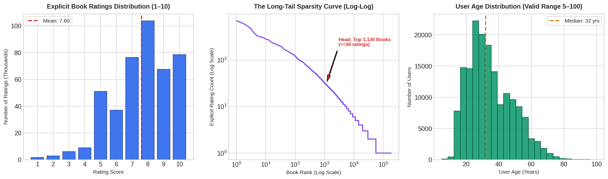
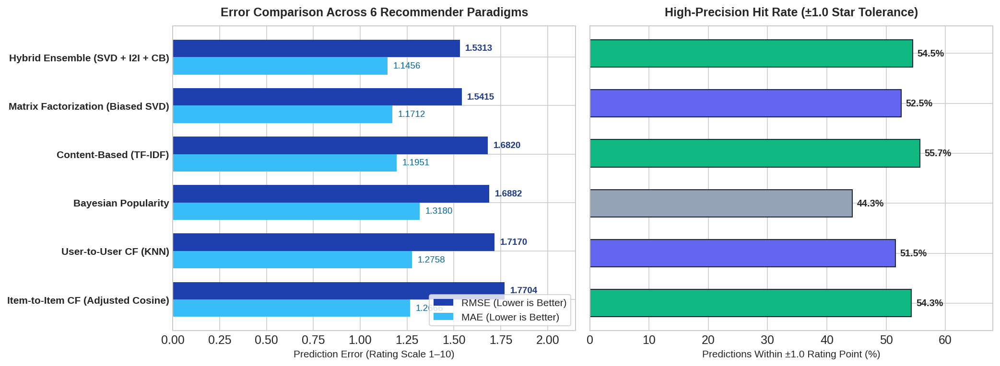

# Decoding Recommendation Engines: Architecture & Empirical Benchmarks

**Author:** Ishan Shrivas (B.Tech CSE - AI & ML, VIT Bhopal)

An end-to-end technical analysis and empirical implementation of modern recommendation systems:
1. **System Architecture Case Study (`/docs`):** Deep-dive analysis into **Amazon** (Item-to-Item Collaborative Filtering, Intent Graphs, Hazard Timing Models) and **Instagram** (Two-Tower Neural Retrieval, Multi-Task Deep Ranking Funnel, Value Functions).
2. **Empirical Paradigm Benchmark (`/src` & `/notebooks`):** Implementation and evaluation of **6 distinct recommender paradigms** on the Book-Crossing dataset (1.14M+ interactions, 271K+ books).

---

## Empirical Benchmark on the Book-Crossing Dataset

### 1. Dataset Exploratory Analysis & Preprocessing
- **Total Catalog (`Books.csv`):** 271,360 unique books across 102,022 authors
- **Total Interactions (`Ratings.csv`):** 1,149,780 ratings — 62.3% implicit ($r=0$) and 37.7% explicit ($r \in [1, 10]$, mean = $7.60$, SD = $1.84$)
- **Evaluation Dense Subset:** Filtered to active users ($\ge 30$ ratings) and books ($\ge 30$ ratings), yielding **28,653 explicit ratings** across **2,179 users** and **1,130 books** (Sparsity: **98.84%**).



---

### 2. Quantitative Model Comparison (80/20 Train-Test Split)

| Recommender Paradigm | Test RMSE ↓ | Test MAE ↓ | Within ±1.0 Star (%) ↑ | Core Mechanism |
| :--- | :---: | :---: | :---: | :--- |
| **Hybrid Ensemble (SVD + I2I + CB)** | **1.5313** | **1.1456** | 54.46% | Weighted cascade (60% SVD + 25% I2I + 15% CB) |
| **Matrix Factorization (Biased SVD)** | 1.5415 | 1.1712 | 52.52% | Regularized SGD with $f=25$ latent factors |
| **Content-Based Filtering (TF-IDF)** | 1.6820 | 1.1951 | **55.66%** | 3,500-dim unigram/bigram cosine similarity |
| **Bayesian Popularity (IMDB Formula)** | 1.6882 | 1.3180 | 44.30% | Damped vote-weighted global baseline |
| **User-to-User CF (Centered KNN)** | 1.7170 | 1.2758 | 51.54% | Mean-centered user neighborhood ($k=20$) |
| **Item-to-Item CF (Adjusted Cosine)** | 1.7704 | 1.2666 | 54.28% | Mean-centered item co-rating similarity ($k=20$) |



---

### 3. Qualitative Discovery Profile (*The Da Vinci Code* by Dan Brown)

| Paradigm | Top Surfaced Recommendations | Behavioral Takeaway |
| :--- | :--- | :--- |
| **Content-Based (TF-IDF)** | 1. *Illuminati* (Dan Brown)<br>2. *Deception Point* (Dan Brown)<br>3. *Angels & Demons* (Dan Brown) | High precision for author/keyword loyalty, but creates a tight filter bubble (zero cross-author serendipity). |
| **Item-to-Item CF** | 1. *The Wedding* (Nicholas Sparks)<br>2. *Bleachers* (John Grisham)<br>3. *The Pact* (Jodi Picoult) | Captures latent demographic co-reading habits across mainstream fiction without needing text metadata. |

---

## Repository Structure

```text
recommender-systems-analysis/
├── assets/
│   ├── dataset_eda_overview.png
│   └── paradigm_benchmark_comparison.png
├── docs/
│   └── Complete_Recommender_Systems_Report.docx
├── notebooks/
│   └── Book_Recommender_Exploration.ipynb
├── src/
│   └── run_benchmark.py
├── .gitignore
├── requirements.txt
└── README.md
```

## How to Run Locally
1. Install dependencies:
   ```bash
   pip install -r requirements.txt
   ```
2. Place `Books.csv`, `Ratings.csv`, and `Users.csv` in the working directory and run:
   ```bash
   python src/run_benchmark.py
   ```
